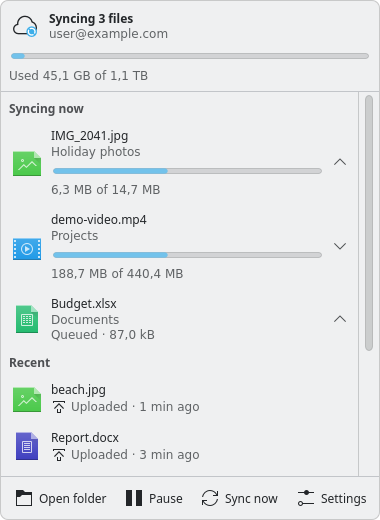

# onedriver (fork)

A fork of [jstaf/onedriver](https://github.com/jstaf/onedriver), the native
Linux filesystem for Microsoft OneDrive, focused on a Windows-like OneDrive
experience on Linux and KDE: files appear instantly and are only downloaded
when used, you can pin folders to keep them offline or free up space again,
and a tray icon, an activity popup and Dolphin integration show what is going
on. Many thanks to Jeff Stafford and the upstream contributors for the
excellent foundation. Licensed under the GPL-3.0, like upstream.

onedriver is not a sync client. It mounts your OneDrive as a FUSE filesystem
and downloads file content on demand, so you get instant access to _all_ of
your files without waiting for a full sync.



_The activity popup (screenshot with made-up data)._

<!-- TODO: add a Dolphin screenshot (overlay emblems + OneDrive context menu) as docs/images/dolphin.png -->

## What's different from upstream

- **On-demand partial reads.** Opening a file does not download it; only the
  parts an application reads are fetched with HTTP Range requests, with
  read-ahead for sequential reads such as video playback. Reading a few KB of
  metadata no longer downloads whole photos. See [Partial downloads](#partial-downloads).
- **Pinning ("always keep on this device") and freeing up space**, per file or
  folder, plus optional automatic eviction by cache size or age
  (`cacheLimit`, `evictAfterDays`).
- **Sync status.** Every file has a state (`cloud`, `local`, `modified`,
  `uploading`, `error`) exposed as `user.onedriver.*` extended attributes, and
  every mount exports a [D-Bus status and control interface](docs/dbus-interface.md).
- **Tray icon** (`onedriver-tray`, StatusNotifierItem) showing up to date /
  syncing / paused / offline / error, with a menu (open folder, recent files,
  pause, sync now, quota) and desktop notifications for conflicts, failed
  uploads and expired logins.
- **Activity popup** (`onedriver-activity`, Qt6/QML/Kirigami), opened by
  clicking the tray icon: running and queued transfers with progress, and
  recently synced files.
- **Dolphin integration:** Windows-style overlay emblems (cloud, green check
  for pinned files, syncing, error) and a OneDrive context menu ("Always keep
  on this device", "Free up space", "View online"), with a Danish translation.
- **Server-side thumbnails.** OneDrive's own thumbnails are written to the
  freedesktop thumbnail cache, so file managers do not download every file
  just to show previews.
- **Personal Vault** is shown as a locked, empty, read-only folder and never
  downloaded.
- **Robust login.** onedriver never pops up a login window by itself and no
  longer crashes on expired tokens. In the "auth-expired" mode the mount keeps
  working from the cache, changes are kept locally, and the tray offers a
  "Log in" action.
- **Conflict copies.** If a file changes both locally and on OneDrive, the
  local version is preserved as a conflict copy instead of being silently
  overwritten.
- **Offline test suite.** `make test` runs against an in-memory mock of
  Microsoft Graph; no account or network needed.
- **Data-loss and stability fixes** found while building the above:
  - a remote change could overwrite unsaved local edits
  - a rewrite of a file during its upload was lost
  - a server-side rename was lost when a local file got its server ID
  - uploads could stall after retries
  - `Open()` held a lock during download and froze file managers
  - files whose size is an exact multiple of 10 MiB failed to download
  - `truncate(2)` on a never-downloaded file uploaded zeros
  - missing `gst-plugins-good` broke the Authenticator number-matching login
    (now a package dependency, with a warning if it is missing)

The default log level is now `info` (it used to be `debug`).

## Install

### Arch Linux / CachyOS / Manjaro / EndeavourOS

Build the package from a checkout of this repository:

```bash
git clone https://github.com/leifrossau/onedriver.git
cd onedriver/pkg/arch
makepkg -si
```

or install the package attached to a
[release](https://github.com/leifrossau/onedriver/releases):

```bash
sudo pacman -U onedriver-fork-*.pkg.tar.zst
```

The package is called `onedriver-fork` and conflicts with the upstream
`onedriver` package (pacman will offer to replace it). It installs onedriver,
the launcher, the tray, the activity popup and the Dolphin plugins. The
systemd unit and binary paths are unchanged, so existing
`onedriver@<path>.service` mounts keep working; restart them to pick up the new
binary. More in [pkg/arch/README.md](pkg/arch/README.md).

Log in once (this opens the login window; the launcher can do it too), then
enable the mount as a service:

```bash
mkdir -p ~/OneDrive
onedriver ~/OneDrive      # log in, then stop it with ctrl-c
systemctl --user enable --now onedriver@$(systemd-escape --path ~/OneDrive).service
```

The tray starts automatically at the next login (`/etc/xdg/autostart`); to start
it now run `onedriver-tray`. Exclude the mount from KDE's Baloo indexer, which
would otherwise read (download) every file:

```bash
balooctl6 config add excludeFolders ~/OneDrive
```

### Other distributions: build from source

You need Go, a C compiler, `pkg-config`, FUSE 3 and development headers for
`webkit2gtk-4.1` and `json-glib`, and `gst-plugins-good` at runtime. The
optional parts need cmake, `extra-cmake-modules` and Qt 6 (`qt6-base`,
`qt6-declarative`) with Kirigami and (recommended) LayerShellQt for the activity
popup, and KF6 `kio` and `ki18n` for the Dolphin plugins.

```bash
make                  # onedriver, onedriver-launcher, onedriver-tray
make activity         # the activity popup
make dolphin          # the Dolphin plugins
sudo make install install-activity install-dolphin PREFIX=/usr
```

The Fedora spec file and Debian packaging inherited from upstream are still in
the tree but are **untested for this fork**. The Copr, OBS, AUR, Nix and Gentoo
packages mentioned in upstream's README install _upstream_ onedriver, not this
fork.

## Usage

Mount from the command line with `onedriver /path/to/mountpoint` (see
`onedriver --help` and `man onedriver`), via the `onedriver-launcher` desktop
app, or as a systemd user service as above. Logs:
`journalctl --user -u onedriver@<escaped path>.service --since today`.

### Pinning and freeing up space

In Dolphin: right click files or folders, then OneDrive > "Always keep on this
device" or "Free up space". On the command line:

```bash
# pin (returns immediately, downloads happen in the background);
# a pinned folder includes files added to it later
setfattr -n user.onedriver.pinned -v 1 ~/OneDrive/Documents
# unpin (keeps the downloaded content)
setfattr -n user.onedriver.pinned -v 0 ~/OneDrive/Documents
# is it pinned? (also 1 for items inside a pinned folder)
getfattr -n user.onedriver.pinned --only-values ~/OneDrive/Documents/report.docx

# free up space: drop downloaded content, files stay visible and are fetched
# again when opened. Pinned, open and not yet uploaded files are skipped.
setfattr -n user.onedriver.evict -v 1 ~/OneDrive/Pictures

# sync state: cloud, local, modified, uploading or error
getfattr -n user.onedriver.state --only-values ~/OneDrive/Documents/report.docx
```

### Partial downloads

Only the parts an application reads are fetched (256 KiB chunks, read-ahead
growing to 8 MiB for sequential reads); files up to 1 MiB are fetched in one go.
A partially downloaded file stays in the `cloud` state. Once every byte has been
read it is verified against OneDrive's QuickXorHash and becomes `local`; on a
mismatch it is downloaded again. Files are always downloaded completely before
they are modified, and pinned files are always downloaded completely. Reading
parts that are not cached fails with an I/O error while offline.

### Configuration

`~/.config/onedriver/config.yml` (an annotated example is in
[pkg/resources/config-example.yml](pkg/resources/config-example.yml)):

```yaml
log: info            # trace, debug, info, warn, error, fatal (or -l/--log)
cacheDir: ~/.cache/onedriver
cacheLimit: 10G      # evict least recently used unpinned content above this size (default: off)
evictAfterDays: 30   # evict unpinned content not opened for this long (default: off)
serverThumbnails: true  # fill the thumbnail cache with OneDrive's thumbnails (default: on)
```

Only content that is not pinned, not open, and has no local changes waiting for
upload is ever evicted.

### D-Bus

```bash
busctl --user list | grep io.github.onedriver
busctl --user call io.github.onedriver.Mount.home_me_OneDrive /io/github/onedriver/Mount \
    io.github.onedriver.Mount1 GetStatus
busctl --user call io.github.onedriver.Mount.home_me_OneDrive /io/github/onedriver/Mount \
    io.github.onedriver.Mount1 Pause
```

The bus name is derived from the escaped mountpoint; the full interface
(properties, transfers, `FileStatesChanged`, `Login`, ...) is documented in
[docs/dbus-interface.md](docs/dbus-interface.md).

### Login expired

If Microsoft rejects the stored login (password changed, app access revoked),
onedriver does not open a window or exit. The mount keeps serving cached files,
changes are kept locally and uploaded after you log in. The tray shows "Login
expired" with a "Log in" action. Without a display, run
`onedriver -n <mountpoint>` in a terminal.

## Development

```bash
make test        # mock-Graph suite for ./fs/... and the tray; no account, needs FUSE
make test-race   # the same with the race detector
make test-activity test-dolphin   # Qt/KF6 unit tests

# the live suite writes to /onedriver_tests in your own account (run make test-init first)
ONEDRIVER_TEST_LIVE=1 make test-live
```

Layout:

| Path | Contents |
|---|---|
| `cmd/onedriver/`, `cmd/onedriver-launcher/` | the filesystem daemon and the GTK launcher |
| `cmd/onedriver-tray/` | tray icon and notifications (pure Go, talks D-Bus) |
| `fs/` | FUSE filesystem: cache, delta sync, uploads, pinning, partial reads, thumbnails |
| `fs/graph/` | Microsoft Graph client and auth; `fs/graph/mockgraph` is the test mock |
| `fs/dbus/` | the D-Bus status/control service |
| `activity/` | the activity popup (Qt6/QML/Kirigami, CMake) |
| `dolphin/` | Dolphin overlay icons and context menu (KF6, CMake) |
| `pkg/arch/` | Arch PKGBUILD; `pkg/resources/`: service, desktop files, man page, config example |
| `docs/` | [D-Bus interface](docs/dbus-interface.md) |

To regenerate the screenshot, run `onedriver-activity` with
`QT_QPA_PLATFORM=offscreen ONEDRIVER_ACTIVITY_SCREENSHOT=out.png` on a session
bus that has a fake `io.github.onedriver.Mount1` service.

## Troubleshooting

In most cases the filesystem reports problems to the program using it (for
example, "read-only filesystem" means you are offline). If it appears to hang,
unmount and remount: `fusermount3 -uz $MOUNTPOINT`, then restart the service.
To reset everything (deletes all locally cached data) run `onedriver -w`.

For bug reports, the most useful things are the logs and steps to reproduce:
`journalctl --user -u onedriver@<escaped path>.service --since today`.

## Known issues

- This fork is KDE/Plasma focused and has only been tested on Arch-based Linux.
  The tray works with any StatusNotifierItem host; the activity popup and
  Dolphin plugins need Qt 6 / KF6.
- Partial reads are verified against OneDrive's hash only once the whole file
  has been fetched.
- Other file managers (Nautilus, ...) work for the filesystem itself but have
  no overlay emblems; with server thumbnails they should not download files for
  previews.
- Microsoft does not support symbolic links on OneDrive (creating one returns
  `ENOSYS`), and does not expose the OneDrive Recycle Bin API; use the web UI
  for that.
- OneDrive is not a backup target; use restic or borg for backups. For
  multi-gigabyte transfers a tool like [rclone](https://rclone.org/) is better
  suited.
- This is a personal project, provided AS IS, with no guarantees.
